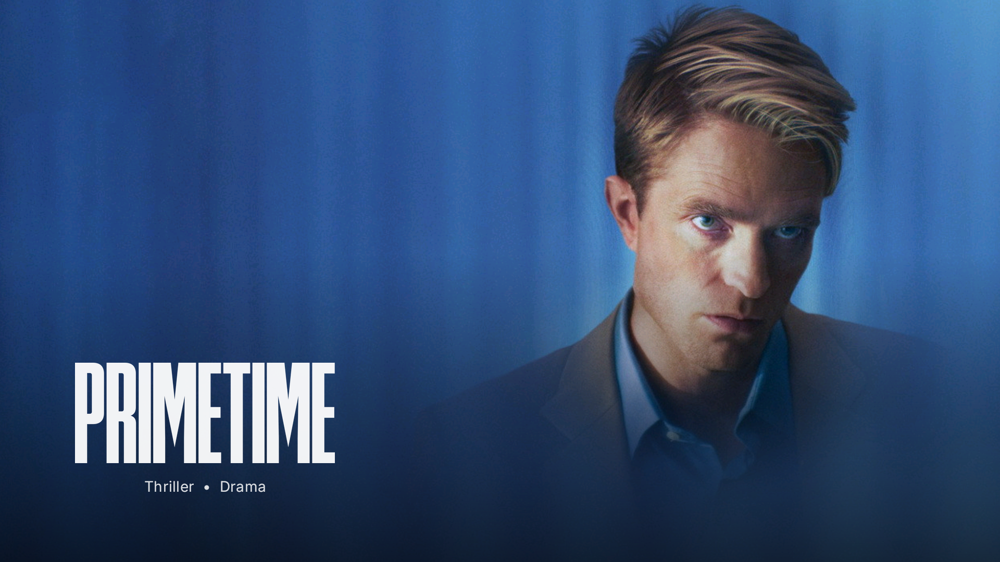
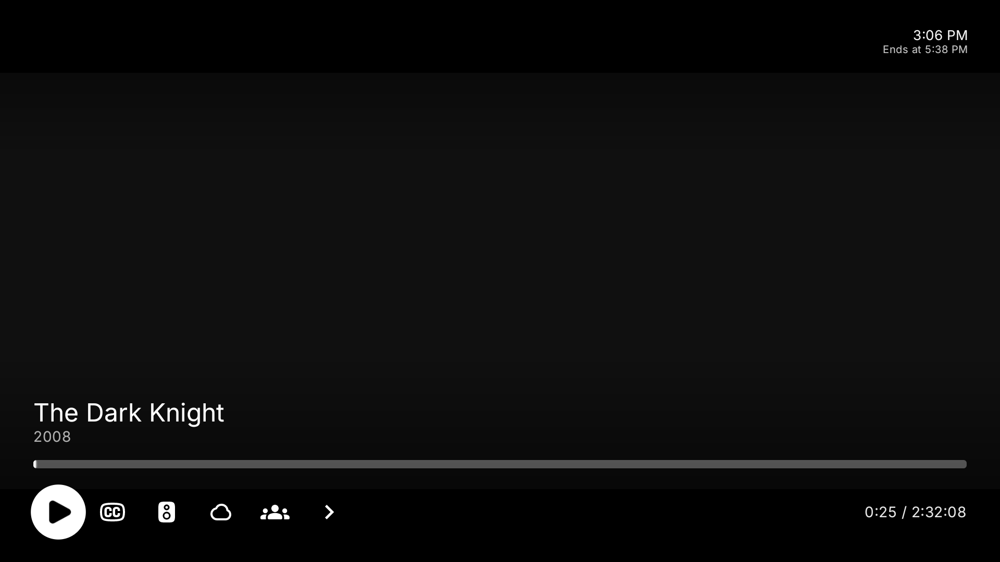

# Direct Streams Providers

[](manifest.json)
[](https://nuvioapp.space)
[](docs/assets/movy_playback_osd.png)

A high-performance, low-memory direct video streaming suite that provides fast, account-free streams for **Nuvio**, **WuPlay**, and **Stremio**.

Currently includes **7movies.ac**, **movy.sx** and **flystream.net**. All scrapers resolve direct MP4 and HLS streams (up to 4K / 2160p) complete with localized subtitle tracks and ExoPlayer native header forwarding.

---

## 📱 Supported Platforms

1. **Nuvio (Android TV, Fire TV, Mobile)**:
   - Runs client-side scrapers in embedded QuickJS.
   - Installable directly via manifest URL below.
2. **WuPlay & Stremio (Android TV, Desktop, Web)**:
   - Compatible with the Stremio Addon Protocol (`/manifest.json`, `/stream/{type}/{id}.json`).
   - Self-hostable locally or deployable to Cloudflare Workers / Vercel.

---

## 📺 Live Android TV Verification

Tested and verified live on **onn. 4K Plus Streaming (Android TV)** running Nuvio TV:

| 7Movies & Movy Stream Selection | Movy 4K HLS Live Playback |
| :---: | :---: |
|  |  |
| *Stream selection sheet with 7Movies MP4s and Movy 4K HLS* | *Live 4K hardware decoding on Amlogic (`c2.amlogic.avc.decoder`), subtitles, and zero buffer stalls* |

---

## Providers

- **7Movies** — resolves 7movies.ac's VidLink upstream: direct MP4, 360p–1080p, with captions.
- **Movy** — resolves movy.sx's stream API (api.wecollege.net). Custom seed handshake ("mvm1") decrypted using 100% pure ECMAScript byte codecs (QuickJS/Hermes safe). Direct HLS up to 2160p (4K) with subtitle tracks. Asks the site's 13 original-audio servers in the site's order (Miami + Boise first, then a sliding window of 3), so titles only the fallback servers carry (e.g. Reno 900p) are found too. See [Movy server fallback](docs/movy-server-fallback.md).
- **FlyStream** — resolves flystream.net's JSON stream API (`/api/streams`), ported from the hostreamio Dart `FlyStreamScraper`: title/year/IMDb looked up from the TMDB id, one row per HLS quality plus an **Auto** row (sources tagged `S1`, `S2`, …), with the challenge-browser session cookies forwarded to ExoPlayer (`reauth=session`). Needs the self-hosted companion (a Raspberry Pi or any Linux box running `server.js`). See [FlyStream Companion Guide](docs/flystream-companion.md).

## ✨ Features & Engineering Optimizations

### 1. ExoPlayer Native Header Forwarding (`behaviorHints`)
- **Fixes HTTP 428 Precondition Required / Stream Blocked**: Media CDNs (`bcdn.hakunaymatata.com`, `moon.goldenkite.top`) reject desktop browser `Mozilla/5.0` User-Agents on byte-range requests without browser bot challenge cookies.
- **Decompiled DEX Architecture**: Reverse engineering of Nuvio TV's DEX (`com.nuvio.tv`) revealed that ExoPlayer's `OkHttpDataSource$Factory` extracts custom request headers from `StreamDto.behaviorHints.proxyHeaders.request` (via `ProxyHeadersDto(request=...)`), not bare top-level headers.
- Streams and HLS variants are bundled with:
  ```json
  "behaviorHints": {
    "notWebReady": true,
    "proxyHeaders": {
      "request": {
        "User-Agent": "okhttp/4.12.0",
        "Referer": "https://www.movy.sx/",
        "Origin": "https://www.movy.sx"
      }
    }
  }
  ```

### 2. Rate-Limit Resilience (HTTP 429 & HTTP 492)
- 7Movies: `fetchWithRetry` with exponential backoff and jitter for upstream rate limits (`HTTP 429`, Cloudflare/Fastly `HTTP 492`), honouring `Retry-After`.
- Movy: one attempt per server, like the site itself; a `429` on `/seed` asks no server and a `429` from a server stops the fallback. Both are cached for 30 s so players' retries do not hammer the API.

### 2b. Bounded Lookups
- Every provider stays inside the router's 9 s per-provider deadline (`PROVIDER_DEADLINE_MS`): Movy and FlyStream run their own 8 s budgets, and timeouts abort the underlying request where the runtime supports it.
- Concurrent identical requests share one in-flight lookup (router and FlyStream); failed lookups are cached briefly (30 s), real "no streams" answers longer.

### 3. $O(1)$ Time & Auxiliary Space Complexity
- **Constrained Hardware Optimization**: Android TV streaming devices typically operate with limited RAM (1.5 GB – 2 GB).
- **Bounded LRU/FIFO In-Memory Caches**:
  - `encCache`: Caches encrypted TMDB hashes for 10 minutes to eliminate redundant HTTP calls to `enc-dec.app`.
  - `streamCache`: Caches resolved stream lists to serve instant re-plays.
- **Streaming HLS Master Parser**: Parses HLS variants using single-pass regex scans rather than splitting multi-megabyte playlist strings into large in-memory arrays, preventing GC pauses in QuickJS / Hermes runtime.

---

## 🚀 Installation on Nuvio

> **Note:** Plugins require the **sideloaded** Nuvio build (Google Play Store builds have plugins disabled by policy).

### Repository Manifest URL:
```text
https://raw.githubusercontent.com/phuanh004/direct-streams-providers/refs/heads/main/manifest.json
```

> **FlyStream on Nuvio** needs the companion: install the repository from the companion instead, e.g. `http://<companion-host>.local:7070/manifest.json`. The companion address is injected into `providers/flystream.js` when the server serves it, so the GitHub copy has none and FlyStream returns no streams there. Prefer the `.local` hostname over an IP: a DHCP change silently breaks an IP-pinned repository.

### Method 1: Remote Install via Web Dashboard (Recommended)
1. On your phone or computer, visit [nuvioapp.space/account](https://nuvioapp.space/account) and sign in.
2. Navigate to **Plugins** → **Add plugin**.
3. Paste the manifest URL above and save.
4. The provider syncs to your TV immediately.

### Method 2: In-App on Android TV
1. Open Nuvio TV → Navigate to **Settings** → **Content & Discovery** → **Plugins**.
2. Click **Manage from phone** (scan QR code) OR paste the manifest URL directly into the **URL or short code** box and click **+ Add**.

> ⚠️ **Important Android TV Setting:**
> In Nuvio TV under **Settings → Content & Discovery → Plugins**, ensure **"Enable plugin providers globally"** is toggled **ON**. If this toggle is disabled, Nuvio will hide all plugin streams during discovery.

---

## 📺 Installation on WuPlay & Stremio

WuPlay and Stremio communicate via the **Stremio Add-on Protocol**. You can run the provider server locally or deploy it serverlessly.

### Run Locally (Zero Dependencies)
```bash
# Start the add-on server on port 7070
npm run serve
```

Install on your device:
- **WuPlay (Android TV)**: WuPlay keeps add-ons in its cloud profile, edited at [config.wuplay.app](https://config.wuplay.app) (scan the QR code under **Settings → Configuration**). Add:
  ```text
  http://<your-host>.local:7070/manifest.json
  ```
  WuPlay calls the add-on from the TV, so a LAN address works; use the hostname so the add-on survives IP changes.
- **Stremio**: In the Stremio search bar, paste:
  ```text
  http://<your-ip>:7070/manifest.json
  ```
  Or click `stremio://<your-ip>:7070/manifest.json`.

---

## 🛠️ Development & Testing

### Prerequisites
- Node.js 18+ (tested up to Node 26)

### Build & Run Tests
```bash
# Clone the repository
git clone https://github.com/phuanh004/direct-streams-providers.git
cd direct-streams-providers

# Install dependencies (esbuild)
npm install

# Bundle scrapers
npm run build

# Offline suites (no network: every upstream is stubbed)
npm run test:offline

# Live end-to-end checks (query the real sites; keep them occasional)
npm test
```

`test:offline` runs `test-offline-units.js`, `test-router-offline.js`, `test-flystream.js`, `test-challenge-browser-offline.js` and `test-movy-offline.js`.

### Test Suite Output
The test runner queries live movie and TV show titles, verifying resolution, subtitle counts, and `behaviorHints` structure:
```text
== Oppenheimer (movie 872585): 1 stream(s)
- [480p] https://bcdnxw.hakunaymatata.com/... subs=11

== Breaking Bad S01E01 (tv 1396): 4 stream(s)
- [1080p] https://bcdn.hakunaymatata.com/... subs=8
- [720p] https://bcdn.hakunaymatata.com/... subs=8
- [480p] https://bcdn.hakunaymatata.com/... subs=8
- [360p] https://bcdn.hakunaymatata.com/... subs=8

== Nonexistent (movie 999999999): 0 stream(s)

✓ All assertion tests passed! SUMMARY movie: 1 tv: 4 missing: 0
```

---

## 🔍 Technical Architecture

```
[Nuvio TV App]
     │
     │ 1. Passes clean TMDB ID (e.g. 1423191)
     ▼
[7Movies Scraper (QuickJS)]
     │
     │ 2. GET https://enc-dec.app/api/enc-vidlink?text={tmdbId}
     │    (Encrypted Hash Cached in Memory O(1))
     ▼
[VidLink Upstream API]
     │
     │ 3. GET https://vidlink.pro/api/b/{movie|tv}/{hash}
     │    (Resolves qualities, direct signed CDN URLs & VTT captions)
     ▼
[Nuvio ExoPlayer (AndroidX Media3)]
     │
     │ 4. Receives stream + behaviorHints.proxyHeaders.request
     │    (User-Agent: okhttp/4.12.0)
     ▼
[HakunaMatata CDN (bcdn.hakunaymatata.com)]
     │
     │ 5. Returns HTTP 206 Partial Content (Bypasses bot-block)
     ▼
[Hardware Video Decoder (c2.amlogic.avc.decoder)]
     │
     └─► Smooth 1080p Playback + Synced Subtitles
```

---

## 📄 License
MIT License. Created and maintained for Nuvio community streaming.
