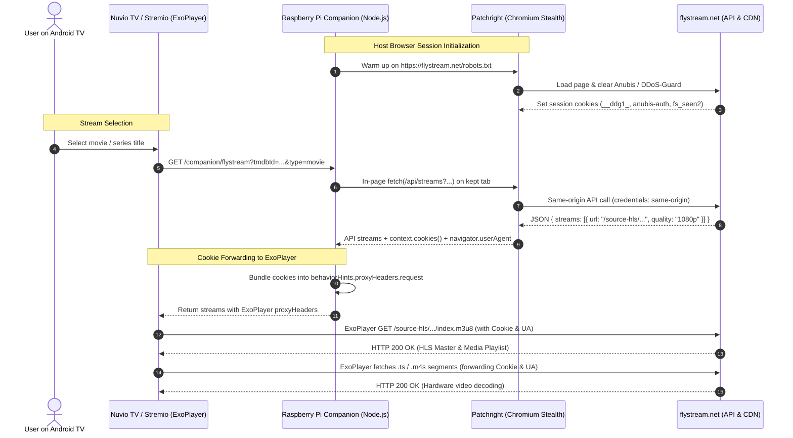

# FlyStream Companion & ExoPlayer Cookie Architecture

This document describes the design, setup, and operational runbook for the **FlyStream Challenge Companion**.

---

## 1. Problem Statement

FlyStream (`flystream.net`) provides multi-quality direct HLS video streams (up to 4K HEVC). However, consuming streams directly from external players presents two distinct security boundaries:

1. **Anti-Bot Interstitial (`/api/streams`)**:
   Top-level HTTP requests or direct Node.js/QuickJS `fetch` calls to `https://flystream.net/api/streams` trigger Anubis or DDoS-Guard challenge screens (`/.within.website/`, `checking your browser`), returning `HTTP 403 Forbidden`. Requests must be made from inside an active, JavaScript-executing browser session.
2. **Session-Locked Stream Playback (`/source-hls/.../index.m3u8`)**:
   Unlike public CDNs, FlyStream's media servers validate the visitor's session cookies (`reauth=session`). If ExoPlayer (in Nuvio TV, WuPlay, or Stremio) requests the `.m3u8` playlist or HLS video chunks without the browser session's cookies (`__ddg1_`, `techaro.lol-anubis-*`, `fs_seen2`), the media server responds with `HTTP 403 Forbidden` (`Playback unavailable`).

---

## 2. Architecture & Data Flow

To resolve this without running a heavy browser directly on Android TV hardware (which runs lightweight embedded QuickJS), the **FlyStream Companion** runs on a local home server (e.g. Raspberry Pi) or workstation.



---

## 3. ExoPlayer Header Forwarding (`behaviorHints`)

Reverse engineering of Nuvio TV's Android application package revealed that ExoPlayer's `OkHttpDataSource$Factory` extracts custom request headers from `StreamDto.behaviorHints.proxyHeaders.request`:

```json
{
  "name": "FlyStream - 1080p",
  "title": "FlyStream The Matrix · 1080p\n1080p · H264",
  "url": "https://flystream.net/source-hls/925ccc8ff0e2c9d6a832860e0aaa8b07/index.m3u8?cv=...",
  "quality": "1080p",
  "headers": {
    "User-Agent": "Mozilla/5.0 (X11; Linux x86_64) AppleWebKit/537.36...",
    "Referer": "https://flystream.net/",
    "Cookie": "__ddg1_=...; techaro.lol-anubis-auth-...=...; fs_seen2=..."
  },
  "behaviorHints": {
    "notWebReady": true,
    "proxyHeaders": {
      "request": {
        "User-Agent": "Mozilla/5.0 (X11; Linux x86_64) AppleWebKit/537.36...",
        "Referer": "https://flystream.net/",
        "Cookie": "__ddg1_=...; techaro.lol-anubis-auth-...=...; fs_seen2=..."
      }
    }
  }
}
```

Because both the master playlist and individual media segments are fetched by ExoPlayer using the configured `OkHttpDataSource$Factory`, every byte-range request carries the session cookie.

---

## 4. Setup Guide: Raspberry Pi & Linux Host

### Step 1: Install Dependencies

On your Raspberry Pi or Debian/Ubuntu server:

```bash
# 1. System Chromium and Xwayland/X11 (pre-installed on Raspberry Pi OS Desktop)
sudo apt update
sudo apt install -y chromium

# 2. Install patchright (stealth Playwright fork) globally or in the project
npm install patchright
```

### Step 2: Environment Configuration

Copy `.env.example` to `.env`:

```bash
cp .env.example .env
```

Edit `.env` to specify your preferred ports and browser settings:

```ini
PORT=7070
HOST=0.0.0.0
CHALLENGE_BROWSER=patchright
CHALLENGE_BROWSER_PROFILE=/home/<user>/.config/dsp-challenge-browser
DISPLAY=:0
```

> 🔒 **Security Notice**: Never commit `.env` containing local network IP addresses or private paths to GitHub. `.env` is ignored in `.gitignore`.

### Step 3: Run the Companion

You can launch the companion interactively using npm:

```bash
npm run companion
```

The script will automatically detect and print your local IP endpoints:
```text
╔═════════════════════════════════════════════════════════════════════════════╗
║                   FlyStream Companion Server (Patchright)                   ║
╚═════════════════════════════════════════════════════════════════════════════╝

📡 Network Endpoints:
   - Local:      http://127.0.0.1:7070
   - LAN (eth0): http://192.168.1.50:7070

📺 Companion Integration URLs:
   - Nuvio TV (FLYSTREAM_COMPANION_URL): http://192.168.1.50:7070
   - Stremio / WuPlay Manifest:        http://192.168.1.50:7070/manifest.json
```

---

## 5. Systemd Service Setup (Auto-Boot)

To keep the companion running 24/7 in the background on your Raspberry Pi:

Create `/etc/systemd/system/direct-streams-providers.service`:

```ini
[Unit]
Description=Direct Streams Providers - Stremio Add-on & FlyStream Companion
After=network.target

[Service]
Type=simple
User=anh
WorkingDirectory=/home/<user>/direct-streams-providers
Environment=PORT=7070
Environment=NODE_ENV=production
Environment=CHALLENGE_BROWSER=patchright
Environment=DISPLAY=:0
ExecStart=/usr/bin/node server.js
Restart=always
RestartSec=5
StandardOutput=journal
StandardError=journal
SyslogIdentifier=direct-streams-providers

[Install]
WantedBy=multi-user.target
```

Reload and enable the service:

```bash
sudo systemctl daemon-reload
sudo systemctl enable --now direct-streams-providers
sudo systemctl status direct-streams-providers
```

---

## 6. Client Configuration

### Stremio & WuPlay
In Stremio or WuPlay, navigate to **Add-ons** → **Community Add-ons** and install by URL:
```text
http://<YOUR_LAN_IP>:7070/manifest.json
```

### Nuvio TV (Android TV)
When running the `flystream` scraper in Nuvio TV:
- If running on the same local network as your companion server, configure `FLYSTREAM_COMPANION_URL`:
  ```ini
  FLYSTREAM_COMPANION_URL=http://<YOUR_LAN_IP>:7070
  ```
- Nuvio TV queries `/companion/flystream?tmdbId=...&type=...` over LAN, retrieves the stream URLs with the server's session cookies, and passes them to ExoPlayer for playback.
- Install the Nuvio repo from the companion (`http://<YOUR_LAN_IP>:7070/manifest.json`), not from GitHub: the companion URL is injected into `/providers/flystream.js` when the server serves it, so a GitHub-installed copy has no companion configured and makes no companion request.
- Several companions: comma-separate them; they are queried in parallel and the first with streams wins (6 s budget).
- The companion routes are **LAN-only** (403 for public clients) and send no CORS headers, because they return live session cookies. Stremio / WuPlay never call them; they use `/stream/...`, which is unchanged. Opt out with `COMPANION_ALLOW_PUBLIC=1`.

---

## 7. Verification & Health Check

### Test Companion Endpoints
```bash
# 1. Check add-on manifest
curl -s http://127.0.0.1:7070/manifest.json

# 2. Check active session cookies
curl -s http://127.0.0.1:7070/companion/flystream/cookies

# 3. Resolve streams for a movie (e.g. The Matrix TMDB ID 603)
curl -s "http://127.0.0.1:7070/companion/flystream?tmdbId=603&type=movie"
```

### Verify Playback from Terminal
Simulate what ExoPlayer does by requesting the resolved `.m3u8` URL with the copied cookies:

```bash
STREAM_URL=$(curl -s "http://127.0.0.1:7070/companion/flystream?tmdbId=603&type=movie" | jq -r '.streams[0].url')
COOKIE_HEADER=$(curl -s "http://127.0.0.1:7070/companion/flystream?tmdbId=603&type=movie" | jq -r '.streams[0].headers.Cookie')

# Test HLS playlist retrieval:
curl -I -s -H "Cookie: $COOKIE_HEADER" -H "Referer: https://flystream.net/" "$STREAM_URL"
# -> HTTP/2 200 (application/vnd.apple.mpegurl)
```

### Android TV Debug Logs (ADB)
To monitor ExoPlayer on your Android TV device:
```bash
adb logcat | grep -iE 'ExoPlayer|com.nuvio.tv|flystream'
```
